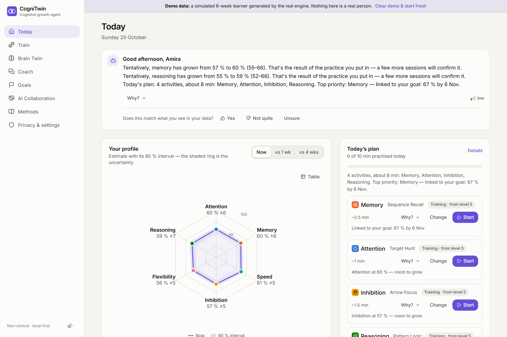

# CogniTwin — a cognitive growth agent with an honest Brain Twin

**CISTAC 1.0 · AI4Brain challenge.** CogniTwin assesses six thinking skills with adaptive, language-free exercises, keeps a living **Brain Twin** that always says how sure it is, coaches with explanations you can check, and adapts every exercise and every daily plan to the learner. Non-clinical by design, local-first, runs without an external AI service when served locally or already loaded in a browser.

▶ **[Watch the 4:51 demo video](https://youtu.be/fU2qwyaGxMk)** — recorded live from the app, English captions. · **Team:** Zaineb Ben Fadhl, Rami Bouzid



> **Try it in 30 seconds:** `npm install && npm run dev`, open http://localhost:5173, accept the consent screen and choose **“Explore a demo twin”** — six weeks of simulated history generated by the real engine, clearly labelled and removable in one click.

---

## Assess · Understand · Coach · Improve

| | What CogniTwin does | Where |
|---|---|---|
| **Assess** | Six procedurally generated, language-free tasks — one per dimension — each with a 10-level difficulty ladder. Check-ins use **computerised adaptive testing** and stop as soon as the estimate is precise. Score, response time, error types and behaviour (interruptions, pauses, corrections, hints, input device) are recorded. A 10-tap **device/motor calibration** makes response windows fair across phones, trackpads and mice. | `src/engine/tasks`, `adaptive.ts`, `quality.ts` |
| **Understand** | A **Bayesian item-response model** turns every trial into an ability estimate with uncertainty. The profile is a **percentage with an 80 % interval and a confidence label**. The **Brain Twin** stores a snapshot after every session (full replayable history) and widens its uncertainty when a skill isn't practised. | `irt.ts`, `twin.ts`, Brain Twin page |
| **Coach** | Deterministic insight detectors find what matters (trends, fast errors, fatigue, switch costs, rule slips, time-of-day effects, self-prediction calibration) **with evidence**. A rule-based coach — optionally rephrased by Claude — narrates them under **guardrails**: no clinical terms, numbers checked against cited evidence, no certainty about the future. Every message has a **“Why?”** panel. | `insights.ts`, `coach/`, `server/coach.ts` |
| **Improve** | Training keeps success near a chosen target (≈ 80 %, the “desirable difficulty” zone). A **transparent utility planner** builds a daily plan with reasons and explains how the plan evolves. Goals become **weekly milestone paths** with a model-based chance of success. Everyday missions bridge exercise gains to real life. | `planner.ts`, `projection.ts`, Train / Goals pages |

### The six dimensions

| Dimension | Task | What changes with the level |
|---|---|---|
| Selective Attention | **Target Hunt** — conjunction visual search | 6 → 49 items, feature → conjunction search, more look-alikes |
| Working Memory | **Sequence Recall** — spatial sequence (Corsi-like) | 2 → 9 tiles, 3×3 → 4×4 board, faster flashes |
| Processing Speed | **Symbol Sprint** — same/different symbol rows | longer rows, swapped neighbours, shorter windows |
| Inhibitory Control | **Arrow Focus** — flanker with STOP (no-go) trials | more conflicting arrows, STOP trials, shorter windows |
| Cognitive Flexibility | **Rule Switch** — shape/colour task switching | more switches, shorter cue preparation, more conflict |
| Abstract Reasoning | **Pattern Logic** — generated 3×3 matrices | 1 → 4 simultaneous rules (progression, distribution), 4 → 8 options |

Each dimension is documented — **definition, task, scoring, uncertainty, biases and mitigations, strategies, references** — in [`docs/DIMENSIONS.md`](docs/DIMENSIONS.md), generated from the same registry the app uses, and in-app on the **Methods** page.

## Mandatory elements of the brief

| Requirement | How it is met |
|---|---|
| Tasks per dimension; score, response time, error rate, behaviour | 6 tasks; per-trial correctness, RT, condition, error type, weight; session metrics (accuracy, on-time success, median RT, RT variability, task-specific costs); behaviour log |
| Each dimension documented (definition, tasks, scoring, uncertainty, biases) | [`docs/DIMENSIONS.md`](docs/DIMENSIONS.md) + Methods page |
| Non-biometric mode mandatory | Default mode; camera and voice are off unless enabled, and every feature works without them |
| Brain Twin: dynamic, historised | Snapshot after every session, replay slider, progress curves, session log, drift of uncertainty over time |
| Projections always with uncertainty | 50 % / 80 % fan charts; goal “chance” labelled as a model estimate; certainty language blocked by guardrails; projection calibration tested in simulation (89 % coverage of the 80 % band) |
| Explainable coaching, justified architecture, no clinical terms | Evidence-backed insights → NLG → guardrails; “Why?” panel; [`docs/COACH.md`](docs/COACH.md), [`docs/ARCHITECTURE.md`](docs/ARCHITECTURE.md); UI copy scanned by a test |
| Difficulty & exercise adaptation, evolving plans | CAT check-ins; target-success training; strain easing; utility planner with plan diffs |
| Radar chart, progress curves, heatmaps, goal tracking | Radar with interval ring + comparison; per-dimension curves with bands; practice calendar, weekly-change and time-of-day heatmaps; goals with milestones |
| AI Collaboration Score 0–100 with documented formula | Beta-smoothed components, weights 20/25/20/20/15 (editable), 80 % interval, sensitivity table — [`docs/COLLABORATION_SCORE.md`](docs/COLLABORATION_SCORE.md) |
| Consent, retention, deletion documented; no sensitive decision on face/voice alone | [`docs/ETHICS_AND_DATA.md`](docs/ETHICS_AND_DATA.md); camera can never decide alone (unit-tested) |

**Bonus features:** voice-based coaching (speech output and input) · emotion-aware coaching (working state fused from behaviour, self-report and optional on-device camera cues) · predictive cognitive growth (Bayesian learning curves, goal probabilities).

## Validation

The engine is validated by simulation (`npm run validate` → [`docs/VALIDATION.md`](docs/VALIDATION.md)): synthetic users with **known** abilities are run through the real adaptive engine.

| Question | Result |
|---|---|
| Does one check-in recover ability? | r = 0.88–0.91 with 10–19 trials; 80 % intervals contain the truth 74–83 % of the time |
| Is adaptive testing worth it? | 27–32 % lower error than random difficulty with the same number of trials |
| Does the twin follow learning honestly? | Interval coverage 73 % (twin) vs 33 % (static model that never forgets) |
| Are projections honest? | The 80 % band contained the true 14-day-ahead level 89 % of the time |
| Does training hit the target difficulty? | Within ~2 points of 88 / 80 / 70 % for gentle / balanced / stretch |
| Is noisy data caught? | Random pressing: 99 % detected, 0 % false alarms |
| Does the AI Collaboration Score discriminate? | Critical collaborator ≈ 75, over-reliant ≈ 41, disengaged ≈ 44, new user ≈ 58 (wide interval) |

Simulation validates the measurement machinery, not construct validity — see *Limitations*.

## Quick start

```bash
npm install
npm run dev          # web app on http://localhost:5173 + API on :8787
```

Optional AI narrative coach: copy `.env.example` to `.env`, set `ANTHROPIC_API_KEY`, restart, and enable “AI narrative coach” in the app’s consent settings. Without a key the coach runs fully offline (rule-based) — nothing breaks.

| Script | Purpose |
|---|---|
| `npm run dev` | Vite dev server + API server |
| `npm run build` / `npm start` | Production build; one server for the app and the API |
| `npm test` | 129 automated tests: engine, six exercise interfaces, page routes, goals, imports, storage failures, privacy, camera/voice adapters, coach fallbacks and API |
| `npm run validate` | Simulation study → `docs/VALIDATION.md` |
| `npm run docs` | Regenerate `docs/DIMENSIONS.md` from the registry |
| `docker build -t cognitwin . && docker run -p 8787:8787 cognitwin` | Containerised deployment |

The static build (`dist/`) also runs on any static host (hash routing, relative paths) with the offline coach.

## Project structure

```
src/
  engine/            pure TypeScript — no DOM, automated tests
    tasks/           six task specs (generators, ladders, metrics, simulation profiles)
    irt.ts           Bayesian item-response model, mastery %, intervals, CAT
    adaptive.ts      within-session controller
    twin.ts          Brain Twin (drift, snapshots, replay)
    insights.ts      evidence-backed detectors
    planner.ts       utility planner, plan diffs, milestones
    projection.ts    Bayesian growth curves, goal probability
    collaboration.ts AI Collaboration Score
    affect.ts        working-state fusion (camera capped)
    quality.ts       data-quality weighting
    coach/           templates, chat intents, guardrails, LLM context, verify game
    demo.ts          demo persona built by the real planner + engine
  components/        UI kit, charts (radar, curves, heatmaps), task views, coach card
  pages/             Today, Train, Session, Brain Twin, Coach, Goals, Collaboration, Methods, Privacy
  store/             zustand + IndexedDB persistence, derived selectors, import schema
server/              stateless Hono API: LLM narrative layer with guardrails
scripts/             validate.ts (simulation study), gen-docs.ts
docs/                architecture, dimensions, coach, collaboration score, ethics, validation, report, pitch
```

## Submission deliverables

| Deliverable | File |
|---|---|
| Demo video (4:51, English captions) | [youtu.be/fU2qwyaGxMk](https://youtu.be/fU2qwyaGxMk) |
| Technical report (6 pages, A4) | [`deliverables/CogniTwin-technical-report.pdf`](deliverables/CogniTwin-technical-report.pdf) — source: [`docs/TECHNICAL_REPORT.md`](docs/TECHNICAL_REPORT.md) |
| Presentation (15 slides, with speaker notes) | [`deliverables/CogniTwin-pitch.pptx`](deliverables/CogniTwin-pitch.pptx) · [PDF](deliverables/CogniTwin-pitch.pdf) |
| Demo video script (≈ 4 min) | [`docs/DEMO_VIDEO_SCRIPT.md`](docs/DEMO_VIDEO_SCRIPT.md) |
| Screenshots | [`docs/screenshots/`](docs/screenshots) |

## Documentation

- [Architecture & decisions](docs/ARCHITECTURE.md)
- [Cognitive dimensions](docs/DIMENSIONS.md)
- [The AI coach](docs/COACH.md)
- [AI Collaboration Score](docs/COLLABORATION_SCORE.md)
- [Ethics, consent & data](docs/ETHICS_AND_DATA.md)
- [Validation report](docs/VALIDATION.md)
- [Phase 2 surprise scenarios](docs/SURPRISE_SCENARIOS.md): button masher, plateau, "why" audit, pushback, fortune teller, asymmetrical mind. Reproducible in the in-app **Robustness lab**.
- [Technical report](docs/TECHNICAL_REPORT.md)
- [Pitch outline](docs/PITCH.md) · [Demo video script](docs/DEMO_VIDEO_SCRIPT.md)

## Limitations

- Difficulty parameters are expert-set priors; a pilot study would calibrate them (Rasch model) and test construct validity with real participants.
- Exercise gains are task-specific unless practised in real life; CogniTwin says so and offers everyday missions instead of claiming far transfer.
- The working-state estimate is coarse — which is why it never changes a score.
- The AI Collaboration Score is a documented design proposal, not a validated scale.

## Credits

Built by **Zaineb Ben Fadhl** and **Rami Bouzid** for CISTAC 1.0 – AI4Brain (IEEE CIS / ENIS, Sfax). MIT licence. Face landmark model © Google (MediaPipe, Apache 2.0). Scientific references are listed in the Methods page and `docs/DIMENSIONS.md`.


## Local verification and remaining submission work

See [CHECKUP.md](docs/CHECKUP.md) for the dated results and limitations, and [LOCAL_SETUP_FR.md](docs/LOCAL_SETUP_FR.md) for Windows setup and the optional API key. The demo video (4:51, English captions) is on YouTube: https://youtu.be/fU2qwyaGxMk. The provided brief does not enumerate its referenced dimension list, so exact alignment with any separate official list is unconfirmed.
