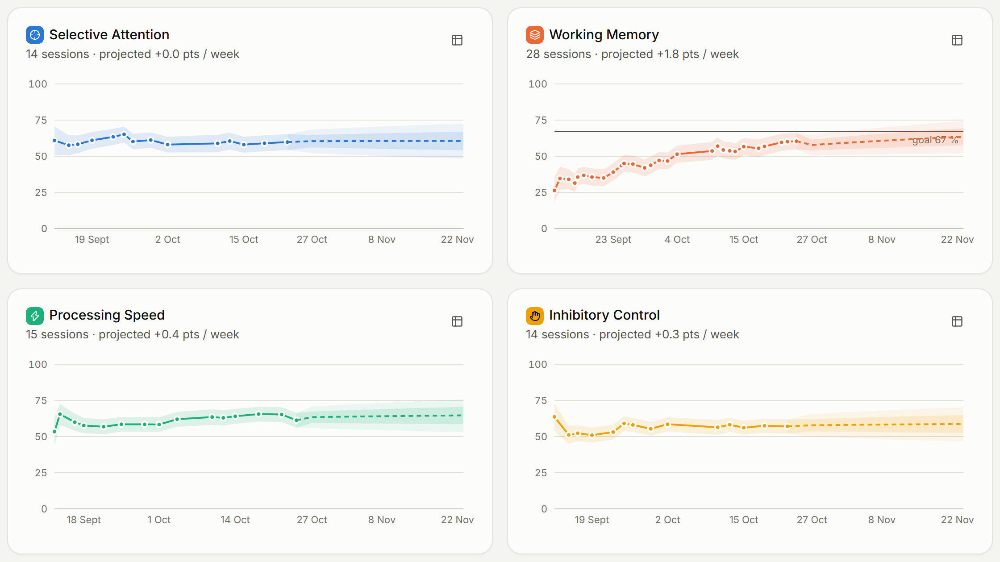
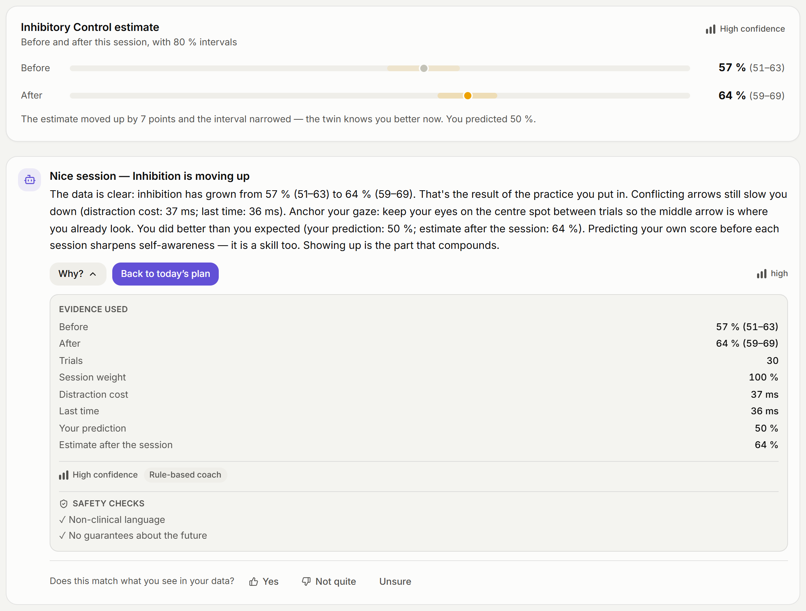
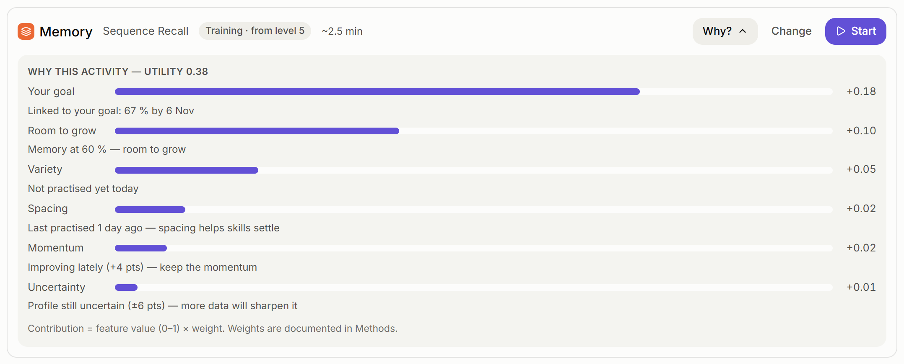
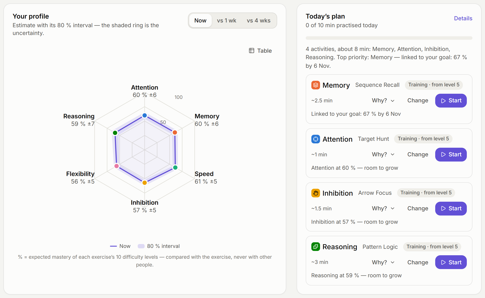
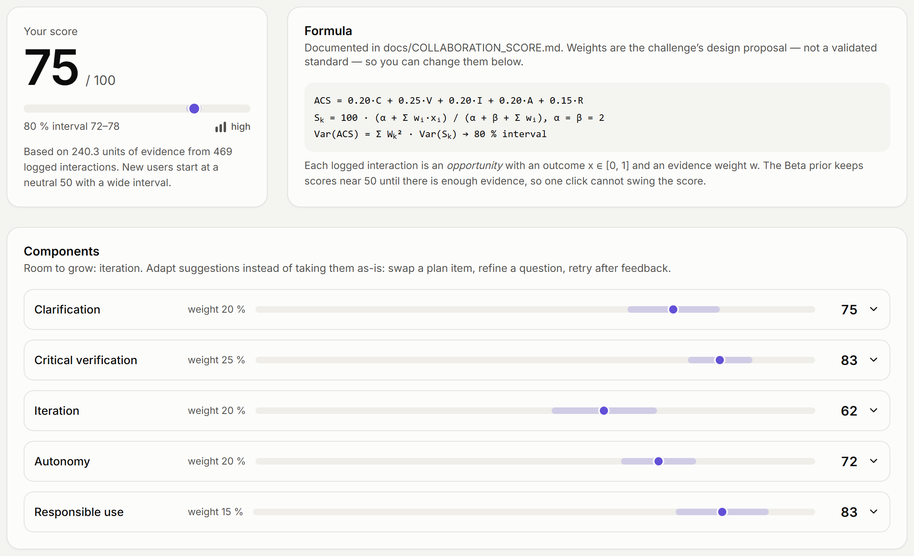

# CogniTwin: an explainable, uncertainty-aware cognitive growth agent with a historised Brain Twin

*Technical report — CISTAC 1.0, AI4Brain challenge*

## Abstract

CogniTwin is a non-clinical cognitive growth agent that continuously assesses six cognitive dimensions, maintains a dynamic and historised *Brain Twin* of the user, coaches with explanations that can be checked, and adapts both exercises and learning plans. Its core is a deterministic engine with automated tests: a Bayesian item-response model over procedurally generated, language-free tasks gives every percentage an 80 % credible interval; computerised adaptive testing shortens assessment; a drifting state-space twin keeps uncertainty honest over time; and a transparent utility planner explains every recommendation. A rule-based coach — optionally rephrased by a large language model — narrates evidence-backed insights under guardrails that check clinical vocabulary, cited numeric evidence and certainty language. An AI Collaboration Score (0–100) with a documented, Beta-smoothed formula measures how well the user works with the AI. A simulation study with synthetic users of known ability shows ability recovery of r = 0.88–0.91 from a single 1–3 minute check-in, a 27–32 % error reduction from adaptive testing, honest interval coverage during learning (73 % vs 33 % for a static model), and cautious projections (89 % coverage of the 80 % band).

## 1. Problem and design principles

Traditional cognitive tests give a one-time, point-estimate result. A *growth* agent must instead (i) measure repeatedly and efficiently, (ii) know and communicate how certain it is, (iii) explain its advice, and (iv) adapt — while never drifting into clinical claims. We adopted four principles:

1. **Facts from a deterministic engine, language from a model.** Every number and finding is computed by testable code and carries its evidence; language models only phrase it.
2. **Uncertainty everywhere.** Every estimate, projection and score is shown with an interval and a confidence label.
3. **Non-clinical and criterion-referenced.** Scores describe mastery of a task's difficulty ladder, not a rank among people or a statement about health.
4. **Choice and privacy by default.** Local-first storage; biometric features off by default and never decisive.

## 2. Layer A — Assessment and profiling

### 2.1 Dimensions and tasks

Six dimensions cover the core executive functions (inhibition, working memory, shifting; Miyake et al., 2000; Diamond, 2013) plus selective attention, processing speed and abstract reasoning. Each has one procedurally generated, language-free task with a 10-level ladder (Table 1). Language-free stimuli reduce language and education bias; procedural generation removes item memorisation.

**Table 1.** Tasks and difficulty ladders.

| Dimension | Task | Paradigm | Difficulty drivers |
|---|---|---|---|
| Selective attention | Target Hunt | Conjunction visual search (Treisman & Gelade, 1980) | set size 6→49, feature→conjunction, more look-alike types |
| Working memory | Sequence Recall | Spatial span (Corsi-like) | span 2→9, board 3×3→4×4, faster flashes |
| Processing speed | Symbol Sprint | Same/different comparison | row length 2→6, swaps, shorter windows |
| Inhibitory control | Arrow Focus | Flanker + go/no-go (Eriksen & Eriksen, 1974) | 25→70 % conflict, 0→20 % STOP, window 1.3→0.76 s |
| Cognitive flexibility | Rule Switch | Cued task switching (Monsell, 2003) | 20→52 % switches, cue lead 600→60 ms, more conflict |
| Abstract reasoning | Pattern Logic | Generated matrices (Carpenter et al., 1990) | 1→4 rules (progression, distribution), 4→8 options |

Every trial records correctness, response time, condition (e.g. congruent/incongruent, switch/repeat), error type (commission, omission, order, perseveration…), difficulty level and a likelihood weight. Session behaviour includes window focus losses and time away, long pauses, corrections, hint use and input device. Task-specific metrics (search slope, distraction cost, switch cost, longest span, rule slips) complement accuracy, on-time success, median RT and RT variability.

### 2.2 Measurement model

A trial is a *success* if correct within its response window. Windows are scaled by a personal calibration factor (1.0–1.6) from a 10-tap simple reaction test, so device latency and motor speed are not mistaken for slower thinking. Success follows a three-parameter item-response model over the ladder:

P(success | θ, ℓ) = c + (1 − c) · σ(a · (θ − b_ℓ)),  b_ℓ ∈ [−2.25, 2.25],

with task-specific discrimination a (1.4–1.7) and chance level c (0–0.2). The posterior over ability θ is computed exactly on a 181-point grid from a Gaussian prior; trials are tempered by their weight (0.3 after an interruption, 0.6 with a hint) and by the session quality weight. The **percentage** shown is the expected mastery of the ten levels, M(θ) = mean_ℓ σ(a(θ − b_ℓ)) × 100, and the **80 % credible interval** is exactly [M(θ₁₀), M(θ₉₀)] because M is monotonic. Confidence labels follow the interval width (high ≤ 16 points, moderate ≤ 30).

### 2.3 Adaptive assessment and data quality

Check-ins are computerised adaptive tests: after two gentle warm-up trials, each trial is drawn at the level maximising expected Fisher information under the current posterior (limited to ±2 levels between trials), and the session stops when the posterior SD reaches a task-specific target (0.42–0.48) or a maximum length. A quality layer flags interruptions, implausibly fast responses (< 150 ms) and random pressing (accuracy indistinguishable from chance with very fast responses); flagged sessions are down-weighted (to 0.2 for random pressing) and the coach is prevented from making confident statements about them.

### 2.4 Brain Twin

For each dimension the twin stores a Gaussian belief N(μ, σ²). Between observations the variance grows by 0.003 per idle day and 0.012 per session (capped at the population prior), so stale knowledge becomes visibly uncertain and real learning can be followed. Each session appends a complete snapshot of all dimensions, giving a replayable history (replay slider, progress curves, session log). Deleting or importing data rebuilds the twin by replaying sessions.

## 3. Layer B — the explainable coach

**Insight detectors** compute findings with evidence and confidence: trends (z-test on posterior means vs ~14 days earlier), speed–accuracy trade-offs, within-session fatigue, RT variability, distraction and switch costs, search efficiency, order errors, the reasoning rule most often broken, plateaus, time-of-day effects (success vs model expectation), and self-prediction calibration.

**Rule-based natural-language generation** narrates the top insights with confidence-proportional hedging, plain-language evidence and one strategy from a referenced library; praise targets process, not traits (Hattie & Timperley, 2007). A conversational mode handles 17 intents with evidence and proposed actions that execute only on the user's click.

**Optional LLM narrative.** When the user opts in, a stateless server sends a de-identified context (estimates, intervals, insights with evidence ids, plan reasons, goals, projections) to Claude (`claude-opus-5-5`, low effort, structured output with server-side refusal fallback). The request also includes the current message and up to six filtered history messages. Profile nickname, raw trials and camera cues are excluded; free-text redaction is partial. Output contains a reply, evidence ids, confidence and suggestions.

**Guardrails** apply to every message: a 38-pattern clinical lexicon; numeric checks on the reply and suggestions against cited source evidence, rejection of unknown evidence ids, and a confidence ceiling; a block on certainty language about the future; PII redaction before any call; fixed reviewed replies for health questions and distress. An unsafe LLM draft is regenerated once with the violation as feedback, then replaced by the template answer. Every message exposes a **"Why?"** panel with its evidence, confidence, source, safety checks and any interception. The UI copy is scanned for the lexicon by a unit test.

**Emotion-aware and voice coaching (bonus).** A coarse *working state* (in the zone, under strain, getting tired, distracted) is fused from behaviour (weight 1.0), optional self-report (0.8) and optional on-device camera cues (0.4; MediaPipe blendshapes aggregated into four averages, no images kept). A state requires ≥ 0.3 non-camera support, so the camera can never decide alone, and the state only changes tone, breaks and training difficulty — never scores. Speech synthesis reads coaching aloud; speech recognition allows spoken questions.

## 4. Layer C — adaptive learning and dashboard

**Within a session**, training selects the level whose predicted success is closest to a target (gentle 88 %, balanced 80 %, stretch 70 %; cf. Wilson et al., 2019), eases after two consecutive misses and temporarily raises the target when strain builds up.

**Across days**, the planner scores each dimension with a transparent utility, U = Σ wᵢ·fᵢ, over normalised features: room to grow (0.25), uncertainty (0.20), goal link (0.25), spacing since last practice (0.15), momentum, variety and user focus (0.05 each), minus a fatigue penalty (0.30) after two sessions in a day. Dimensions with wide intervals receive a check-in instead of training. Each item shows its contributions, and each new plan is diffed against the previous one ("Reasoning switched from check-in to training — the profile is now confident enough").

**Goals** (score or habit) generate weekly milestones. **Projections** fit a saturating learning curve θ(t) = α + β·log(1 + t/7) by Bayesian linear regression on the twin history, with inflated observation variance (history points are autocorrelated) and a horizon-growing drift term; they are drawn as 50 %/80 % fans and turned into a model-based goal probability that is always labelled as an estimate.

**Dashboard.** Radar chart with an uncertainty ring and comparison overlay; progress curves with interval bands and projections; three heatmaps (practice calendar, weekly change, time of day); goal tracking; every chart has a table view. Colours are a validated colour-blind-safe categorical palette; identity is never colour-only.

## 5. AI Collaboration Score

ACS = 0.20·C + 0.25·V + 0.20·I + 0.20·A + 0.15·R (clarification, critical verification, iteration, autonomy, responsible use). Each logged interaction is an opportunity with outcome x ∈ [0,1] and weight w; each component is the posterior mean of a Beta(2,2)–Bernoulli model, S = 100·(2 + Σwx)/(4 + Σw), so new users start at a neutral 50 with a wide interval. Var(ACS) = Σ W²·Var(S) gives an 80 % interval. Indicators include opening "Why?", clarifying and specific questions, accepting low-confidence suggestions without checking (negative), rating claims, an openly announced *Verify the coach* game in which one of three statements about the user's data is deliberately wrong, plan edits and follow-ups, self-set goals, self-prediction accuracy, hint reliance, informed consent, PII sharing (negative) and taking suggested breaks. Weights are the brief's unvalidated proposal; users can change them and see a sensitivity table. The full indicator table is in `docs/COLLABORATION_SCORE.md`.

## 6. Ethics, consent and data

Data is stored locally (IndexedDB, with localStorage/memory fallbacks); there are no accounts or server database. Optional AI narration sends aggregates and filtered conversation text to the provider; browser voice services may also process text or audio externally. Consent is granular, off by default, logged and revocable. The non-biometric mode is complete. Retention removes expired raw trials, camera aggregates and derived camera evidence; states are recomputed without camera. JSON imports are capped at 25 MB and validated before mutation; the twin is replayed, missions and weights restored, plans regenerated, and permissions never activated by an import. Users can erase sessions, categories or all data. These controls do not certify legal compliance of a deployment.

## 7. Validation

Because real participants were not available within the challenge, we validated the machinery by simulation (`npm run validate`, seeded, ~13 s): synthetic users with known abilities and learning curves answer the real tasks through the real engine, with lapses, log-normal response times and interruptions.

**Table 2.** Main results.

| Experiment | Result |
|---|---|
| Single check-in, 300 users × 6 tasks | r = 0.88–0.91, RMSE 0.41–0.49 logits, 80 % coverage 74–83 %, 10–19 trials |
| Adaptive vs random difficulty | error −27 % to −32 % for the same trial count |
| Tracking 20 sessions of learning | twin RMSE 0.30, coverage 73 %; static model RMSE 0.39, coverage 33 % |
| 14-day projections | 89 % of true future levels inside the 80 % band; MAE 6.1 points |
| Training difficulty targeting | 86 / 78 / 70 % observed vs 88 / 80 / 70 % targets |
| Random pressing | 99 % detected, 0 % false alarms |
| Collaboration archetypes | critical 75, new user 58, disengaged 44, over-reliant 41 |

The 31 October 2026 local check-up passed 127 automated tests: engine, six exercise interfaces, pages, goals, privacy, import, storage, API and simulated camera/voice/provider failures. Typecheck, production build and simulations passed. Live LLM calls and real camera/microphone capture remain unverified. Browser visual automation was blocked by its URL-verification tool; Docker execution was unavailable because the daemon was stopped. A CI workflow is provided but no public CI run is claimed.

## 8. Limitations and future work

Item parameters are expert-set priors; a pilot study should calibrate them with a Rasch model and test construct validity against established tasks. Simulation validates estimation, not the meaning of the constructs. Exercise gains may not transfer beyond the tasks (Melby-Lervåg & Hulme, 2013; Simons et al., 2016), so the coach frames progress as task progress and proposes everyday missions. Within-session learning leaves twin coverage slightly below nominal. The working-state estimate is coarse and the ACS is a design proposal; both are presented with their limits. Future work: on-device item calibration across users (federated, with consent), multilingual coaching, accessibility studies with older adults, and an evaluation of the ACS against expert ratings of human–AI collaboration.

## References

Barrett, L. F. et al. (2019). Emotional expressions reconsidered. *Psychological Science in the Public Interest*, 20, 1–68.
Carpenter, P. A., Just, M. A. & Shell, P. (1990). What one intelligence test measures. *Psychological Review*, 97, 404–431.
Diamond, A. (2013). Executive functions. *Annual Review of Psychology*, 64, 135–168.
Eriksen, B. A. & Eriksen, C. W. (1974). Effects of noise letters upon the identification of a target letter. *Perception & Psychophysics*, 16, 143–149.
Hattie, J. & Timperley, H. (2007). The power of feedback. *Review of Educational Research*, 77, 81–112.
Melby-Lervåg, M. & Hulme, C. (2013). Is working memory training effective? *Developmental Psychology*, 49, 270–291.
Miyake, A. et al. (2000). The unity and diversity of executive functions. *Cognitive Psychology*, 41, 49–100.
Monsell, S. (2003). Task switching. *Trends in Cognitive Sciences*, 7, 134–140.
Simons, D. J. et al. (2016). Do "brain-training" programs work? *Psychological Science in the Public Interest*, 17, 103–186.
Treisman, A. & Gelade, G. (1980). A feature-integration theory of attention. *Cognitive Psychology*, 12, 97–136.
van der Linden, W. J. & Glas, C. A. W. (2010). *Elements of Adaptive Testing*. Springer.
Wilson, R. C. et al. (2019). The Eighty Five Percent Rule for optimal learning. *Nature Communications*, 10, 4646.
